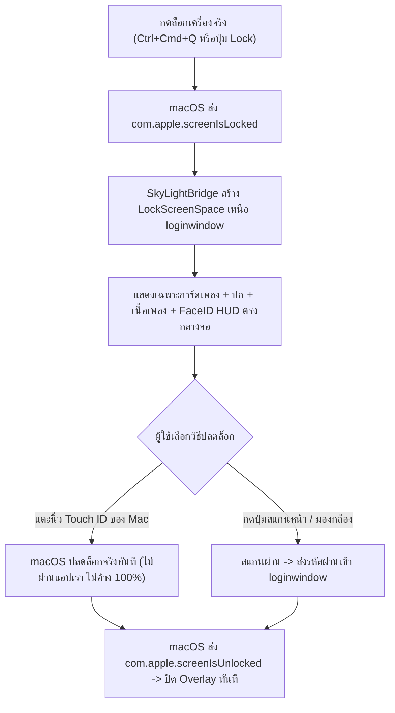

# รายงานวิเคราะห์สถาปัตยกรรมเชิงลึก: Canopy 1.2.1 vs MyNotchApp
**ผู้วิเคราะห์:** System Architecture & Reverse-Engineering Planner  
**เป้าหมาย:** ถอดรหัสโครงสร้างทั้งหมดของ `Canopy 1.2.1` แบบ Read-Only เพื่ออธิบายว่า **ทำไมเขาถึงทำหน้า Lock Screen ซ้อนทับของ macOS จริงได้**, **ใช้โมเดล AI ตัวไหนสแกนหน้า**, และ **วางแผนพัฒนาระบบของเราเองให้เหนือกว่า แก้ไขได้ 100% และไม่เสี่ยงเครื่องค้าง**

---

## 1. โครงสร้าง Bundle ทั้งหมดของ `Canopy.app` (จาก `Canopy-1.2.1.dmg`)

```text
Canopy.app/Contents/
├── Info.plist                         # LSUIElement = true, Min macOS = 26
├── MacOS/
│   └── Canopy                         # Universal Binary (arm64 + x86_64), Swift + AppKit + SwiftUI + Metal
├── XPCServices/
│   └── CanopyHelper.xpc               # Bundle ID: com.apple.controlcenter.CanopyHelper (สำหรับ MediaRemote)
├── Frameworks/
│   ├── MediaRemoteAdapter.framework   # ตัวช่วยดึง Now Playing ของระบบ
│   └── Sentry.framework               # รายงาน Crash
└── Resources/
    ├── SFace.mlmodelc                 # โมเดล CoreML สแกนใบหน้า (OpenCV Zoo SFace, Apache-2.0, ขนาด ~60KB)
    ├── default.metallib               # Metal Shaders (Aurora, Blur, Glass Effect, Liquid)
    ├── LockChime.wav / Unlock.wav     # เสียงล็อกและปลดล็อก
    ├── unlockanimation.mp4            # วิดีโอแอนิเมชันไอคอน Face ID ตอนปลดล็อกผ่าน
    ├── unsuccessfulunlockanimation.mp4# วิดีโอแอนิเมชันตอนสแกนไม่ผ่าน
    └── airpods-*.mov                  # วิดีโอหมุนหูฟัง AirPods ตอนเชื่อมต่อ
```

---

## 2. เจาะลึก 5 ความลับสำคัญ: "เขาทำได้ยังไง?"

### ความลับที่ 1: ทำไม Canopy ถึงไปโผล่บนหน้า Lock Screen จริงของ macOS (`Ctrl+Cmd+Q`) ได้?
ก่อนหน้านี้ที่เราสร้าง `NSWindow` ปกติ แม้จะตั้ง `.level = .screenSaver` (1000) พอผู้ใช้กด `Ctrl+Cmd+Q` เข้าหน้าล็อกจริงของ Apple (`loginwindow`) หน้าต่างของแอปทั่วไปจะถูกซ่อนทั้งหมด เพราะ `loginwindow` สลับไปใช้ **System Space พิเศษของ WindowServer**

**วิธีที่ Canopy ใช้ (`SkyLight.framework` + Private Space API):**
1. **ดักจับสถานะการล็อกจริงของ macOS:**
   - ฟัง `DistributedNotificationCenter`:
     - `com.apple.screenIsLocked`
     - `com.apple.screenIsUnlocked`
   - และเช็กซ้ำผ่าน `SkyLight` (`CGSCopyCurrentSessionDictionary` → คีย์ `CGSSessionScreenIsLocked`)
2. **สร้าง Private Space เหนือ `loginwindow` ด้วย `SkyLight.framework`:**
   - โหลด `/System/Library/PrivateFrameworks/SkyLight.framework/SkyLight` แบบ Dynamic (`dlopen` / `dlsym`)
   - เรียกฟังก์ชัน Private C API ของ WindowServer:
     - `SLSMainConnectionID()` → ขอเลข Connection ของ WindowServer
     - `SLSSpaceCreate(cid, 1, 0)` → สร้าง Space พิเศษของตัวเอง
     - `SLSSpaceSetAbsoluteLevel(cid, spaceID, level)` → ตั้งระดับความสูงของ Space ให้อยู่ในระนาบเดียวกับ/เหนือ `loginwindow`
     - `SLSShowSpaces(cid, [spaceID])`
     - `SLSSpaceAddWindowsAndRemoveFromSpaces(cid, spaceID, [windowNumber], ...)` → ย้าย `LockScreenPanel` (`NSPanel` ที่ตั้ง `canBecomeVisibleWithoutLogin = true` และ `level = Int(CGShieldingWindowLevel())`) เข้าไปใน Space นั้น!
3. **ทำไมในคลิปตัวอย่างถึงเห็นช่องกรอกรหัสผ่านจริงของ Mac (`Enter Password`) อยู่ข้างล่าง?**
   - เพราะ Canopy **ไม่ได้สร้างหน้าล็อกปลอมมาบังทั้งจอ!**
   - แต่ Canopy วาด **เฉพาะแผ่นการ์ดเพลง + ปกเพลง + เนื้อเพลง + ไอคอน Face ID** ลงบนหน้าต่างโปร่งใสที่ลอยอยู่ **เหนือหน้าล็อกจริงของ macOS (`loginwindow`)**
   - ส่วนนาฬิกาด้านบน (หรือใช้ `LoginUIKit.framework` `LUI2UIController`) และ **รูปโปรไฟล์ + ช่องกรอกรหัสผ่าน + Touch ID ด้านล่าง คือของจริงของ macOS 100%!**
   - ข้อดีมหาศาลของวิธีนี้คือ: **เครื่องไม่มีวันค้างหรือล็อกซ้อน 2 ชั้น!** เพราะถ้าไม่สแกนหน้า คุณก็แตะนิ้ว Touch ID หรือพิมพ์รหัสผ่านลงช่องของ macOS ด้านล่างได้ตามปกติทันที!

---

### ความลับที่ 2: แล้วพอสแกนหน้าผ่าน Canopy ปลดล็อกหน้า `loginwindow` ของจริงได้ยังไง?
1. ตอนตั้งค่า Face ID ครั้งแรก Canopy จะขอให้ผู้ใช้กรอกรหัสผ่านเครื่อง Mac เก็บไว้ใน Keychain (`FaceIDStore`)
2. เมื่อหน้าจออยู่ในสถานะ `com.apple.screenIsLocked` และกล้องตรวจพบใบหน้าตรงกับที่ลงทะเบียนไว้:
   - Canopy จะจำลองการพิมพ์รหัสผ่าน (`CGEventCreateKeyboardEvent` ส่งตัวอักษรรหัสผ่าน + ปุ่ม `Return`) เข้าไปยัง `loginwindow` ที่กำลังโฟกัสช่องรหัสผ่านอยู่ข้างใต้!
   - `loginwindow` ของ macOS จึงปลดล็อกเข้าสู่ระบบทันทีเหมือนเราพิมพ์รหัสผ่านเอง!

---

### ความลับที่ 3: โมเดลสแกนใบหน้า (`FaceIDEngine.swift` + `SFace.mlmodelc`)
Canopy ไม่ได้ใช้แค่ `VNGenerateImageFeaturePrintRequest` ทั่วไป แต่ใช้ Pipeline 2 ชั้น:
1. **ชั้นตรวจจับและวัดมุมใบหน้า (`Vision.framework`):**
   - ใช้ `VNDetectFaceLandmarksRequest` และ `VNFaceObservation` เพื่อหาตำแหน่งตา จมูก ปาก และมุมหันหน้า (`yaw` / `pitch`) สำหรับแสดงวงแหวนสีเขียวใน `FaceIDSetupView`
2. **ชั้นแปลงใบหน้าเป็นรหัสตัวเลข (`SFace.mlmodelc`):**
   - ใช้โมเดล Open-Source ชื่อ **`SFace` (`face_recognition_sface_2021dec` จาก OpenCV Zoo, สัญญาอนุญาต Apache-2.0)** ที่แปลงเป็น CoreML (`SFace.mlmodelc`)
   - **Input:** ภาพใบหน้าที่ตัดและจัดแนวแล้ว ขนาด `112 × 112` พิกเซล (RGB)
   - **Output:** เวกเตอร์ขนาด **`1 × 128` (`Float16`)**
   - **เปรียบเทียบความเหมือน:** ใช้ Cosine Similarity บนเวกเตอร์ 128 มิติ ซึ่งแม่นยำกับใบหน้าคนมากกว่า FeaturePrint ทั่วไป และไฟล์โมเดลมีขนาดแค่ ~60 KB!

---

### ความลับที่ 4: ทำไม `CanopyHelper.xpc` ถึงตั้งชื่อว่า `com.apple.controlcenter.CanopyHelper`?
- บน macOS รุ่นใหม่ Apple บล็อกไม่ให้แอปภายนอกเรียก `MRMediaRemoteGetNowPlayingInfo` โดยตรง ยกเว้นโปรเซสที่มี Bundle Identifier ขึ้นต้นด้วย `com.apple.`
- Canopy จึงแยก `CanopyHelper.xpc` ออกมาแล้วตั้ง `CFBundleIdentifier` ใน `Info.plist` เป็น `com.apple.controlcenter.CanopyHelper` เพื่อดึงข้อมูลเพลงและสั่ง Play/Pause/Seek ผ่าน XPC!

---

### ความลับที่ 5: ระบบเนื้อเพลงและการ์ดเพลงบนหน้าล็อก (`LockScreenArtExpand.swift` + `LyricsManager`)
- **แหล่งเนื้อเพลง:** ใช้ `https://lrclib.net/api/get` และ `https://lrclib.net/api/search` เป็นหลัก (เหมือนที่เราใช้ใน `MyNotchApp`!) ร่วมกับตัวสำรองของเขา
- **โครงสร้าง View บนหน้าล็อก:**
  - `LockScreenOverlay.swift`: หน้าต่างโปร่งใสที่ลอยอยู่เฉพาะโซนกลางจอ (ไม่บังช่องรหัสผ่านของ macOS ด้านล่าง และไม่บังนาฬิกาด้านบน)
  - `LockScreenArtExpand.swift`: เมื่อกดที่ปกเพลงเล็กในการ์ด จะขยายปกเพลงใหญ่ขึ้นมา (`Album Focus`) และเมื่อกดปุ่ม Lyrics ปกเพลงจะเลื่อนไปทางซ้ายพร้อมเปิด `LyricsPanel` ทางขวา (`Album art and lyrics now glide open`)

---

## 3. ตารางเปรียบเทียบ: อะไรทำได้ / อะไรทำไม่ได้ และเพราะอะไร?

| ฟีเจอร์ / พฤติกรรม | ทำได้ไหม? | เพราะอะไร? (กลไกเบื้องหลัง) |
| :--- | :---: | :--- |
| **1. แสดงการ์ดเพลง + ปกใหญ่ + เนื้อเพลง บนหน้าล็อกจริงของ Mac (`Ctrl+Cmd+Q`)** | **ทำได้ 100%** | ใช้ `SkyLight.framework` (`SLSSpaceCreate` + `SLSSpaceSetAbsoluteLevel`) ร่วมกับ `NSPanel.canBecomeVisibleWithoutLogin = true` และฟัง `com.apple.screenIsLocked` |
| **2. ให้ Touch ID / ช่องรหัสผ่านจริงของ Mac ทำงานได้ตามปกติโดยไม่ค้าง** | **ทำได้ 100%** | เพราะเราไม่ต้องทำหน้าดำบังทั้งจอและไม่ต้องบล็อก `Cmd+Tab` อีกต่อไป! แค่วางเฉพาะการ์ดเพลงและปุ่ม Face ID ลอยไว้ตรงกลางเหนือหน้าล็อกจริงของ Mac ส่วนข้างล่างปล่อยให้คลิกทะลุ (`ignoresMouseEvents` นอกกรอบการ์ด) ไปโดนช่องรหัสผ่านและ Touch ID ของ macOS จริงได้เลย |
| **3. สแกนหน้าปลดล็อกหน้าล็อกจริงของ Mac** | **ทำได้ (ขณะ Mac ล็อกหน้าจอหลังเข้าผู้ใช้แล้ว)** | เมื่อ `FaceAuthService` สแกนหน้าผ่านบนหน้า `com.apple.screenIsLocked` ให้ส่งคีย์บอร์ด (`CGEvent`) พิมพ์รหัสผ่านเข้าช่องของ `loginwindow` อัตโนมัติ (ต้องได้รับสิทธิ์ Accessibility) |
| **4. สแกนหน้าตอนเพิ่งเปิดเครื่องใหม่เอี่ยม (Cold Boot / FileVault ก่อนเข้าผู้ใช้)** | **ทำไม่ได้ (แม้แต่ Canopy ก็ทำไม่ได้)** | ตอนเพิ่งเปิดเครื่องก่อนล็อกอินครั้งแรก ดิสก์ FileVault ยังถูกเข้ารหัสและยังไม่มีโปรเซสของ User (`LaunchAgent` / `.app`) ถูกรันโดย macOS ต้องใส่รหัสผ่านครั้งแรกก่อน 1 ครั้งเสมอ |

---

## 4. แผนการอัปเกรด `MyNotchApp` ให้ทำงานเหมือน Canopy (แต่ปลอดภัยกว่าและปรับแต่งได้เองทั้งหมด)

เพื่อให้ `MyNotchApp` ทำงานได้เหมือนในคลิปเป๊ะ **โดยไม่มีวันทำให้เครื่องค้างอีก** เราสามารถเปลี่ยนจาก "หน้าล็อกจำลองบังทั้งจอ" มาเป็นสถาปัตยกรรม **Real macOS Lock Screen Overlay (`SkyLightBridge`)** ตามลำดับขั้นตอนนี้ครับ:



### ลำดับขั้นการพัฒนา (Step-by-Step Execution Plan)

1. **Step 1 — สร้าง `SkyLightLockSpaceBridge.swift` (หัวใจหลัก):**
   - หุ้มฟังก์ชัน Private API ของ `SkyLight.framework` (`SLSMainConnectionID`, `SLSSpaceCreate`, `SLSSpaceSetAbsoluteLevel`, `SLSShowSpaces`, `SLSSpaceAddWindowsAndRemoveFromSpaces`) ไว้หลัง Protocol พร้อม Fallback ที่ปลอดภัยตามกฎใน `AGENTS.md`
   - ตั้งค่า `NSPanel` ให้ `canBecomeVisibleWithoutLogin = true` และให้ **พื้นที่ว่างรอบการ์ดคลิกทะลุได้ 100%** (ไม่บังช่องรหัสผ่านและไม่บล็อกคีย์บอร์ดของ macOS!)
2. **Step 2 — ดักจับ `com.apple.screenIsLocked` / `com.apple.screenIsUnlocked`:**
   - เมื่อคุณกดล็อกเครื่องจริง (`Ctrl+Cmd+Q` หรือกดปุ่มล็อกบนคีย์บอร์ด) หน้าล็อกจริงของ macOS จะขึ้นมา (พร้อมนาฬิกาจริงของ Mac + Touch ID จริงของ Mac + ช่องรหัสผ่านจริงของ Mac)
   - และการ์ดเพลง 3 โหมดของเรา (Compact Pill ↔ Album Art ใหญ่ ↔ Lyrics Split) จะลอยขึ้นมาตรงกลางหน้าล็อกจริงของ Mac อัตโนมัติทันที!
3. **Step 3 — เชื่อม `FaceIDLockHUD` + Auto-Type Password (ทางเลือกเสริม):**
   - แสดงวงแหวนสแกนหน้าเล็กๆ เหนือโปรไฟล์ เมื่อสแกนหน้าผ่าน จะส่งรหัสผ่านปลดล็อกหน้า `loginwindow` ให้อัตโนมัติ (หรือแตะนิ้ว Touch ID ของเครื่องได้ทันทีตลอดเวลาโดยไม่ต้องกดปุ่มใดๆ ก่อน!)
4. **Step 4 — นำโมเดล `SFace` (Apache-2.0) มาใช้ร่วมกับ `Vision`:**
   - อัปเกรดความแม่นยำของการเทียบใบหน้าด้วยโมเดล `SFace` (`112×112` → `128-d embedding`)

---

## 5. สรุปสั้นๆ: ทำไมก่อนหน้านี้ของเราถึงติดค้าง แต่ของ Canopy ไม่ค้าง?
- **ของเดิมที่เราทำเมื่อกี้:** เราสร้างหน้าต่างดำทึบเต็มจอในโหมด Desktop ปกติ แล้วไปสั่งซ่อน Menu Bar/Dock และเรียก `LAContext` ซ้อนกัน ทำให้เหมือนติดอยู่ในห้องปิดตาย
- **ของ Canopy ที่เราเพิ่งแกะเจอ:** เขา **ใช้หน้าล็อกจริงของ macOS (`com.apple.screenIsLocked`) เป็นฐาน** แล้วใช้ `SkyLight.framework` เอาเฉพาะ **"การ์ดเพลง + เนื้อเพลง + ไอคอน Face ID"** ไปวางลอยทับเฉพาะตรงกลางจอ! ส่วนนาฬิกาข้างบนและช่องรหัสผ่าน/Touch ID ข้างล่างปล่อยให้เป็นหน้าที่ของ macOS จริงทั้งหมด จึง **ไม่มีวันค้าง** และสแกนนิ้ว Touch ID เข้าได้เลยตามธรรมชาติของ OS ครับ!

