# แผนแม่บทอัปเกรดระบบขั้นสุด: `MyNotchApp` Ultimate Dev Cockpit & OS Integration (`U1`–`U8`)

เอกสารนี้คือ **พิมพ์เขียวการพัฒนาระดับ Production (Master Implementation & Verification Spec)** ที่รวมจุดแข็งของ **12 โปรเจกต์ Open-Source บน GitHub** + **สถาปัตยกรรมภายในของ Canopy 1.2.1** + **ฟีเจอร์สาย Developer Cockpit (`ROADMAP.md`)** เข้าด้วยกันอย่างสมบูรณ์แบบ

---

## กฎเหล็กของสถาปัตยกรรม (Architecture & Safety Invariants)
ทุกเฟส (`U1`–`U8`) ต้องรักษากฎเหล็กของ `AGENTS.md` อย่างเคร่งครัด:
1. **Single Way In & Pure State:** ทุกการเปลี่ยนแปลงสถานะต้องไหลผ่าน `NotchStore.send(NotchEvent)` บน `@MainActor` และคำนวณใน `NotchReducer.reduce(&state, event)` ที่เป็น Pure Function เท่านั้น
2. **Swift 6 Strict Concurrency:** `swift build` ต้องผ่านแบบ **0 warnings** ห้ามใช้ `@unchecked Sendable` หรือ `nonisolated(unsafe)` โดยไม่มีคอมเมนต์อธิบายเหตุผลด้าน Thread-safety ที่ชัดเจน
3. **Private API Protocol & Fallback:** ทุกการเรียกใช้ Private Framework (เช่น `SkyLight.framework`, `MediaRemote.framework`, `OSD.framework`) ต้องอยู่หลัง Protocol และโหลดผ่าน `dlopen`/`dlsym` เสมอ หาก macOS อัปเดตแล้วไม่มีสัญลักษณ์นั้น แอปต้อง Fallback กลับไปใช้ Public API โดยไม่แครช 100%
4. **Zero Lockup Guarantee:** ห้ามใช้ `.disableProcessSwitching` หรือสร้างหน้าต่างทึบบังช่องรหัสผ่านของระบบจนผู้ใช้สลับแอปไม่ได้ ทุก Overlay ต้องมีทางออกฉุกเฉิน (`Esc`, `⌥⌘U`) และปล่อยให้คลิกทะลุพื้นที่ว่าง (`ignoresMouseEvents`) เสมอ
5. **Near-Zero Idle CPU:** ห้าม Poll ถี่เกินจำเป็นในสถานะ Collapsed ใช้ Event-driven (`DistributedNotificationCenter`, `FSEvents`, `IOKit`, `NWListener` Unix Domain Socket) เป็นหลัก
6. **Test-First Gate (`(U)` + `(V)`):** เขียน Unit Test (`import Testing`) สำหรับ Pure Logic ก่อนเสมอ และต้องผ่านทั้ง `(U)` Unit Test และ `(V)` Visual/Live Verification ก่อนติ๊ก `[x]`

---

## ภาพรวมลำดับการพัฒนา 8 เฟส (`U1` → `U8`)

```mermaid
flowchart LR
    U1["U1: SkyLight Real Lock Screen"] --> U2["U2: SFace 128-d & Auto-Unlock"]
    U2 --> U3["U3: Multi-Source Lyrics (NetEase/QQ)"]
    U3 --> U4["U4: Bezier Notch Ears & Trackpad Swipe"]
    U4 --> U5["U5: Volume & Brightness Notch HUD (B1)"]
    U5 --> U6["U6: AirPods Battery & Spectrum Bars"]
    U6 --> U7["U7: One-Click AirDrop & Media Guard"]
    U7 --> U8["U8: Docker Glance (B3) & Live SDK"]
```

---

## รายละเอียดการพัฒนาและการทดสอบรายเฟส

### [x] Phase U1: `SkyLightLockSpaceBridge` — เอาการ์ดเพลง 3 โหมดไปลอยบนหน้า Lock Screen จริงของ macOS
**ต้นแบบจาก:** `Lakr233/SkyLightWindow`, `NUIKit/CGSInternal`, `Canopy_v2/LockScreenOverlay.swift`

#### 1. ทำไมต้องใช้สถาปัตยกรรมนี้
- แทนที่จะสร้างหน้าจอดำทึบจำลองขึ้นมาบังทั้งจอ เราจะฟังสัญญาณ **`com.apple.screenIsLocked`** และ **`com.apple.screenIsUnlocked`** จาก `DistributedNotificationCenter`
- เมื่อคุณล็อกเครื่องจริงของ Mac (`Ctrl+Cmd+Q` หรือกดปุ่มล็อกเครื่อง) macOS จะแสดงหน้าล็อกของจริง (มีนาฬิกาจริงของ Mac ด้านบน + รูปโปรไฟล์ ช่องรหัสผ่าน และ **Touch ID ของจริง** ด้านล่าง)
- เราใช้ `SkyLight.framework` สร้าง Space พิเศษระดับสูง (`SLSSpaceCreate` + `SLSSpaceSetAbsoluteLevel`) เพื่อนำเฉพาะ **การ์ดเพลง 3 โหมด (Compact ↔ Album Focus ↔ Lyrics Split) + ปุ่มสแกนหน้า** ไปลอยอยู่ **เฉพาะโซนกลางจอ** เหนือ `loginwindow`!
- **พื้นที่นอกการ์ดคลิกทะลุได้ 100%** แปลว่าคุณแตะนิ้ว Touch ID ของเครื่องปุ๊บ เข้าเครื่องได้ทันที ไม่มีวันค้าง!

#### 2. ไฟล์ที่จะสร้าง/แก้ไข
- `Sources/NotchKit/Window/SkyLightBridge.swift` *(สร้างใหม่)*:
  - โหลด `/System/Library/PrivateFrameworks/SkyLight.framework/SkyLight` ด้วย `dlopen`
  - ผูกฟังก์ชัน `SLSMainConnectionID`, `SLSSpaceCreate`, `SLSSpaceDestroy`, `SLSSpaceSetAbsoluteLevel`, `SLSShowSpaces`, `SLSHideSpaces`, `SLSSpaceAddWindowsAndRemoveFromSpaces`, `CGSCopyCurrentSessionDictionary`
  - มี `SkyLightSpaceProviding` protocol เพื่อให้เขียน Mock ทดสอบได้ใน Unit Test
- `Sources/NotchKit/Window/LockScreenPanel.swift` *(สร้างใหม่)*:
  - `NSPanel` ที่ตั้งค่า `canBecomeVisibleWithoutLogin = true`, `isFloatingPanel = true`, `backgroundColor = .clear`, `hasShadow = false`
  - คำนวณ Hit-testing เฉพาะกรอบการ์ดเพลงและปุ่ม Face ID (พื้นที่นอกนั้น `ignoresMouseEvents = true`)
- `Sources/NotchKit/Window/LockScreenWindowController.swift` *(อัปเกรด)*:
  - รองรับ 2 โหมดการทำงาน:
    1. **System Lock Overlay Mode (อัตโนมัติเมื่อกด `Ctrl+Cmd+Q`):** ลอยเฉพาะการ์ดเพลง + เนื้อเพลง + ปุ่ม Face ID เหนือหน้า `loginwindow` จริงของ macOS
    2. **Preview / Manual Overlay Mode (`⌥⌘L`):** เปิดดูพรีวิวบนหน้า Desktop พร้อมปุ่ม `Esc` / `⌥⌘U` ออกได้ทันที

#### 3. ขั้นตอนการทดสอบ (Verification Gate)
- **(U) Unit Test (`Tests/NotchKitTests/SkyLightBridgeTests.swift`):**
  - ทดสอบ `SkyLightBridge.isLoaded` และการจัดการสถานะ `SystemLockStateMonitor` (เมื่อได้รับ event `screenIsLocked` → สร้าง Space และแสดง Panel; เมื่อได้รับ `screenIsUnlocked` → ซ่อนและคืนทรัพยากรทันที)
  - ทดสอบการคำนวณ Hit-rect ของการ์ดเพลงทั้ง 3 โหมด (`compact`, `albumFocus`, `lyricsSplit`) ว่าไม่ทับโซนช่องรหัสผ่านด้านล่างของหน้าจอ
- **(V) Live Check:**
  1. เปิดเพลงทิ้งไว้ แล้วกด `Ctrl+Cmd+Q` เพื่อล็อกเครื่องจริงของ Mac
  2. ยืนยันว่าการ์ดเพลงลอยขึ้นมากลางหน้าล็อกจริงของ Mac กดสลับดูเนื้อเพลงได้ และแตะนิ้ว Touch ID ของ Mac เพื่อปลดล็อกได้ทันที

---

### [x] Phase U2: `SFace` Alignment Pipeline & Auto-Unlock `loginwindow`
**ต้นแบบจาก:** `opencv/opencv_zoo (face_recognition_sface)`, `Canopy_v2/FaceIDEngine.swift`

#### 1. รายละเอียดเชิงเทคนิค
- **Face Alignment (5-Point Affine Crop → `112×112`):**
  - ดึงจุดตาซ้าย, ตาขวา, ปลายจมูก, มุมปากซ้าย, มุมปากขวา จาก `VNFaceLandmarks2D`
  - หมุนปรับระนาบใบหน้าให้ตรง (Roll Normalization) และตัดภาพขนาด `112×112` เพื่อให้ค่า Embedding คงที่แม้เอียงคอเล็กน้อย
- **Multi-Angle Template Fusion:**
  - เก็บเวกเตอร์ใบหน้าแยกตาม 5 มุมหลัก (ตรง, ซ้าย, ขวา, เงย, ก้ม) และคำนวณ L2-normalized Cosine Similarity ร่วมกับ Liveness Check (การกระพริบตา `BlinkDetector`)
- **System Lock Auto-Type (ทางเลือก เปิด/ปิดได้):**
  - หากผู้ใช้อยู่ในหน้า `com.apple.screenIsLocked` และกดสแกนหน้าผ่าน สามารถตั้งค่าให้ส่งคีย์บอร์ด (`CGEvent`) เพื่อปลดล็อก `loginwindow` หรือปลดล็อกโหมด Preview ได้ทันที

#### 2. ไฟล์ที่จะสร้าง/แก้ไข
- `Sources/NotchKit/Services/FaceAuth/FaceAligner.swift` *(สร้างใหม่ — Pure geometry & CoreImage crop)*
- `Sources/NotchKit/Services/FaceAuth/FaceAuthService.swift` *(อัปเกรด)*
- `Tests/NotchKitTests/FaceAuthTests.swift` *(เพิ่มเทส `FaceAligner`)*

#### 3. ขั้นตอนการทดสอบ (Verification Gate)
- **(U) Unit Test:** ทดสอบ `FaceAligner.computeAlignedCropRectAndAngle` กับพิกัดตาซ้าย/ขวาที่เอียง `±15°` ว่าคืนค่ามุมหมุนและกรอบ `112×112` ที่ถูกต้อง
- **(V) Live Check:** สแกนใบหน้าใน `Setup Face Unlock…` แล้วทดลองปลดล็อกในสภาพแสงจริงและตอนเอียงศีรษะเล็กน้อย

---

### [x] Phase U3: Multi-Source Lyrics Engine (`NetEase` + `QQ Music` + Sync Offset `±0.5s`)
**ต้นแบบจาก:** `ddddxxx/LyricsX`, `WuBarlynn/LyricsX_2.0`, `Canopy_v2/LyricsManager`

#### 1. รายละเอียดเชิงเทคนิค
- ปัญหาที่เจอ: เพลงจีน เพลงแร็ป เพลงไทยอินดี้ หรือเวอร์ชันพิเศษ (เช่น `猜不透 (说唱版)`) บางเพลงไม่มีในฐานข้อมูล `LRCLib`
- **วิธีแก้แบบ `LyricsX`:** สร้าง Pipeline ค้นหาเนื้อเพลงแบบ Waterfall 3 ชั้น + ปรับเวลาได้:
  1. **ชั้นที่ 1 — `LRCLibClient`** (เร็วที่สุด มีทั้งเพลงสากล/ไทย/เอเชีย)
  2. **ชั้นที่ 2 — `NetEaseLyricsClient` (`music.163.com/api/search/get` + `/api/song/lyric`)** — ฐานข้อมูลเนื้อเพลงแบบมีเวลา (`[mm:ss.xx]`) ที่ใหญ่ที่สุดสำหรับเพลงจีน/ญี่ปุ่น/เกาหลี/เอเชีย (รวมถึงเพลง `猜不透 (说唱版)`!)
  3. **ชั้นที่ 3 — `SafariYouTubeMusicLyricsClient`** — ดึงจากแท็บ YouTube Music ใน Safari
- **ปุ่มปรับ Lyrics Sync Offset (`-0.5s` / `+0.5s`):**
  - เพิ่มปุ่มเล็กๆ `-0.5s` / `+0.5s` บนมุมขวาของกรอบเนื้อเพลง (ทั้งใน Notch และบน Lock Screen) เพื่อขยับจังหวะเนื้อเพลงให้ตรงเป๊ะตามใจชอบ และจำค่า Offset รายเพลงไว้ใน `LyricsCache`!

#### 2. ไฟล์ที่จะสร้าง/แก้ไข
- `Sources/NotchKit/Services/Media/NetEaseLyricsClient.swift` *(สร้างใหม่)*
- `Sources/NotchKit/Services/Media/LyricsCache.swift` *(รองรับ Fallback ไปยัง `NetEaseLyricsClient` + เก็บ `offset` รายเพลง)*
- `Sources/NotchKit/Views/MediaViews.swift` & `LockScreenView.swift` *(เพิ่มปุ่ม `-0.5s` / `+0.5s`)*
- `Tests/NotchKitTests/NetEaseLyricsTests.swift` *(สร้างใหม่)*

#### 3. ขั้นตอนการทดสอบ (Verification Gate)
- **(U) Unit Test:** ทดสอบ `NetEaseLyricsClient` ด้วย Mock `URLProtocol` (แปลง JSON ค้นหา `songId` → ดึง `lrc.lyric` → คัดกรองความยาวเพลง `±4s`) และทดสอบการปรับ `LRCDocument.withOffset(delta)`
- **(V) Live Check:** เปิดเพลง `猜不透 (说唱版)` หรือเพลงเอเชียที่ไม่มีใน LRCLib แล้วยืนยันว่าเนื้อเพลงแบบวิ่งตามเวลาขึ้นครบ และกด `-0.5s` / `+0.5s` ขยับจังหวะได้ทันที

---

### [x] Phase U4: Smooth Bezier Notch Ears & Trackpad Two-Finger Swipe Gesture
**ต้นแบบจาก:** `MrKai77/DynamicNotchKit`, `TheBoredTeam/boring.notch`

#### 1. รายละเอียดเชิงเทคนิค
- **Smooth Concave Top Ears (`NotchEarShape`):**
  - แทนที่จะใช้ `UnevenRoundedRectangle` ธรรมดาซึ่งมุมบนซ้าย/ขวาตั้งฉากกับขอบจอ เราจะวาด `Path` ที่มี **เส้นโค้งเว้าด้านบนซ้ายและขวา (Top-left & Top-right Concave Bezier Ears รัศมี `6pt`–`10pt`)** โค้งรับกับขอบดำของจอ MacBook เหมือนหยดน้ำที่เป็นเนื้อเดียวกับรอยบากกล้อง
- **Trackpad Two-Finger Swipe Gesture:**
  - ดัก `NSEvent.EventTypeMask.scrollWheel` เฉพาะเมื่อเมาส์อยู่บนพื้นที่ Notch:
    - **ปัดสองนิ้วลง (Swipe Down):** กาง Notch ออกเป็นโหมด `expanded` พร้อม Haptic feedback เบาๆ
    - **ปัดสองนิ้วขึ้น (Swipe Up):** พับเก็บกลับเป็น `collapsed` ทันที
    - **ปัดสองนิ้วซ้าย/ขวา (Swipe Left/Right ขณะกางอยู่):** สลับแท็บ (`Home ↔ Media ↔ Tools ↔ Notes ↔ Mirror ↔ Pulse`) อย่างลื่นไหล!

#### 2. ไฟล์ที่จะสร้าง/แก้ไข
- `Sources/NotchKit/Geometry/IslandLayout.swift` *(เพิ่มคำนวณจุดควบคุม Bezier ของหู Notch)*
- `Sources/NotchKit/Views/NotchRootView.swift` *(ใช้ `NotchIslandShape` ที่มีหูโค้งเว้าด้านบน)*
- `Sources/NotchKit/Window/NotchWindowController.swift` *(ดัก `scrollWheel` gesture สำหรับปัดเปิด/ปิด/สลับแท็บ)*
- `Tests/NotchKitTests/ScreenGeometryTests.swift` *(เพิ่มเทส `NotchIslandShape` path bounds)*

#### 3. ขั้นตอนการทดสอบ (Verification Gate)
- **(U) Unit Test:** ทดสอบ `SwipeGestureRecognizer` (Pure state machine ที่รับค่า `scrollingDeltaX`, `scrollingDeltaY`, `phase`) ว่าแยกแยะ Swipe Down / Swipe Up / Swipe Left / Swipe Right ได้โดยไม่ลั่นซ้ำระหว่าง momentum phase
- **(V) Live Check:** เอาเมาส์ชี้ที่ Notch แล้วปัดสองนิ้วลง/ขึ้น/ซ้าย/ขวา เพื่อเปิด ปิด และสลับแท็บ

---

### [x] Phase U5: Native Notch HUD สำหรับ Volume, Brightness & Keyboard Backlight (Roadmap `B1`)
**ต้นแบบจาก:** `AlexPerathoner/SlimHUD`, `TheBoredTeam/boring.notch`, Roadmap `B1`

#### 1. รายละเอียดเชิงเทคนิค
- เมื่อกดปุ่ม **เพิ่ม/ลดเสียง, Mute, หรือเพิ่ม/ลดความสว่างหน้าจอ** บนคีย์บอร์ด MacBook:
  - ดักจับ `NSEvent.EventType.systemDefined` (`subtype == 8`, คีย์ `NX_KEYTYPE_SOUND_UP`, `NX_KEYTYPE_SOUND_DOWN`, `NX_KEYTYPE_MUTE`, `NX_KEYTYPE_BRIGHTNESS_UP`, `NX_KEYTYPE_BRIGHTNESS_DOWN`, `NX_KEYTYPE_ILLUMINATION_UP`, `NX_KEYTYPE_ILLUMINATION_DOWN`)
  - อ่านค่าระดับเสียงจาก `AudioDeviceService` และอ่านค่าความสว่างหน้าจอจาก `DisplayServicesGetBrightness` / `CoreDisplay` (ผ่าน dynamic `dlsym` พร้อม fallback)
  - แสดง **Notch Slim HUD Toast** (`key: "hud:volume"` หรือ `"hud:brightness"`) ที่มีไอคอนแอนิเมชัน (`speaker.wave.1/2/3.fill` หรือ `sun.max.fill`) + แถบ Progress Bar เรียบหรูใน Notch แทน!

#### 2. ไฟล์ที่จะสร้าง/แก้ไข
- `Sources/NotchKit/Services/Audio/MediaKeyHUDMonitor.swift` *(สร้างใหม่)*
- `Sources/NotchKit/State/Toast.swift` *(เพิ่ม `progress: Double?` สำหรับแสดงหลอดระดับเสียง/แสงใน `ToastView`)*
- `Sources/NotchKit/Views/ToastView.swift` *(วาดแถบหลอดความยาวสมูทเมื่อ `toast.progress != nil`)*
- `Tests/NotchKitTests/MediaKeyHUDTests.swift` *(สร้างใหม่)*

#### 3. ขั้นตอนการทดสอบ (Verification Gate)
- **(U) Unit Test:** ทดสอบการถอดรหัส `data1` ของ `NSEvent.systemDefined` (`keyCode = (data1 & 0xFFFF0000) >> 16`, `keyFlags = data1 & 0x0000FFFF`, `keyDown = ((keyFlags & 0xFF00) >> 8) == 0x0A`) ทั้งปุ่มเสียงและปุ่มความสว่าง
- **(V) Live Check:** กดปุ่มเพิ่ม/ลดเสียงและเพิ่ม/ลดแสงบนคีย์บอร์ด ยืนยันว่าหลอด HUD กางออกจาก Notch อย่างสมูท

---

### [x] Phase U6: AirPods Battery Ring Popup & Live Audio Spectrum Bars
**ต้นแบบจาก:** `exelban/stats`, `TheBoredTeam/boring.notch`, `Canopy_v2/AirPodsMonitor.swift`

#### 1. รายละเอียดเชิงเทคนิค
- **AirPods & Bluetooth Battery Reader (`AirPodsBatteryMonitor.swift`):**
  - อ่านข้อมูลจาก `IOKit` (`AppleDeviceManagementHIDEventService` / `IOBluetoothDevice`) และ `system_profiler SPBluetoothDataType -json` เฉพาะตอนมี event หูฟังเชื่อมต่อเปลี่ยนสถานะ (`CoreAudio` Default Output Device เปลี่ยน หรือ Bluetooth notification — **ไม่ Poll ตลอดเวลา!**)
  - ดึงค่า `BatteryPercentLeft`, `BatteryPercentRight`, `BatteryPercentCase` หรือ `BatteryPercentSingle`
  - เมื่อเชื่อมต่อ AirPods / หูฟังบลูทูธ: เด้ง Toast พิเศษใน Notch โชว์ไอคอน `airpodspro` / `Beats` พร้อมเปอร์เซ็นต์แบตเตอรี่ **L / R / Case**!
- **Live Audio Spectrum Visualizer:**
  - ยกระดับคลื่นเสียงในหู Notch (`CollapsedEarsView`) และในการ์ดเพลงให้ขยับตามจังหวะความถี่อย่างมีชีวิตชีวาเมื่อเพลงเล่นอยู่

#### 2. ไฟล์ที่จะสร้าง/แก้ไข
- `Sources/NotchKit/Services/Audio/AirPodsBatteryMonitor.swift` *(สร้างใหม่)*
- `Tests/NotchKitTests/AirPodsBatteryTests.swift` *(สร้างใหม่ — ทดสอบ Parser ของ Bluetooth JSON / IOKit dictionary)*

#### 3. ขั้นตอนการทดสอบ (Verification Gate)
- **(U) Unit Test:** ทดสอบ `AirPodsBatteryParser.parse` กับ Fixture ข้อมูล Bluetooth ของ macOS (แยกชื่อหูฟัง, แบตข้างซ้าย, ข้างขวา, เคส)
- **(V) Live Check:** เชื่อมต่อหูฟังบลูทูธ/AirPods ยืนยันว่าแสดงชื่อและเปอร์เซ็นต์แบตเตอรี่ใน Notch

---

### [x] Phase U7: One-Click AirDrop ใน File Tray & Media Key Guard
**ต้นแบบจาก:** `Lakr233/NotchDrop`, `FuzzyIdeas/MusicDecoy`

#### 1. รายละเอียดเชิงเทคนิค
- **One-Click AirDrop (`NSSharingService(named: .sendViaAirDrop)`):**
  - ในถาดพักไฟล์ (`FileTray` ใน `ExpandedView`) และตอนลากไฟล์มาวางเหนือ Notch (`fileDrop` mode):
  - เพิ่มโซน/ปุ่ม **`AirDrop`** สีฟ้า (`airplayaudio` / `wave.3.up.circle.fill`) — เมื่อกดปุ่มหรือลากไฟล์มาปล่อยที่โซน AirDrop จะเรียกหน้าต่างส่ง AirDrop ของ macOS ให้ส่งไฟล์เข้า iPhone / iPad / Mac เครื่องอื่นได้ทันทีในคลิกเดียว!

#### 2. ไฟล์ที่จะสร้าง/แก้ไข
- `Sources/NotchKit/Views/ToastView.swift` & `NotchRootView.swift` *(เพิ่มปุ่ม AirDrop ใน File Tray และโซน Drop)*
- `Sources/NotchKit/App/AppCoordinator.swift` *(เชื่อม `NSSharingService(named: .sendViaAirDrop)?.perform(withItems: urls)`)*

#### 3. ขั้นตอนการทดสอบ (Verification Gate)
- **(U) Unit Test:** ทดสอบ Action การส่งรายการ `stagedFiles` เข้า AirDrop handler
- **(V) Live Check:** ลากไฟล์เข้า Notch แล้วกดปุ่ม **AirDrop** ยืนยันว่าหน้าต่าง AirDrop ของ macOS เด้งขึ้นมาพร้อมไฟล์นั้นทันที

---

### [x] Phase U8: Docker Container Glance (Roadmap `B3`) & Developer Live Activity CLI
**ต้นแบบจาก:** Roadmap `B3`, `Ebullioscopic/Atoll`

#### 1. รายละเอียดเชิงเทคนิค
- **Docker Glance (`DockerGlanceMonitor.swift`):**
  - เชื่อมต่อ `/var/run/docker.sock` (หรือ `~/.docker/run/docker.sock` สำหรับ Docker Desktop บน macOS) ผ่าน `NWConnection` Unix Domain Socket (`GET /containers/json?all=false`) เฉพาะเมื่อเปิดดู Notch หรือทุก 10 วินาทีขณะกางออก
  - แสดงรายการ Container ที่กำลังรันอยู่ (`Name`, `Image`, `State`, `Status`, `Ports`) ในแท็บ Developer Cockpit
  - มีปุ่ม **Restart Container** (`POST /containers/{id}/restart`) และปุ่ม **Tail Logs** (ส่งเข้า `D4 Log Pin` เพื่อเฝ้าดู `ERROR|Exception` อัตโนมัติ!)
- **อัปเดต `docs/ROADMAP.md`:**
  - ติ๊ก `[x]` สำหรับ `B1`, `B2` (ทำไว้แล้วใน `AndroidDropServer`), และ `B3` จนครบ **100% ของ Roadmap ทั้งหมด!**

#### 2. ไฟล์ที่จะสร้าง/แก้ไข
- `Sources/NotchKit/Services/DevServers/DockerGlanceMonitor.swift` *(สร้างใหม่)*
- `Sources/NotchKit/State/NotchState.swift` & `NotchReducer.swift` *(เพิ่ม `dockerContainers: [DockerContainer]`)*
- `Sources/NotchKit/Views/ToastView.swift` *(แสดงแถว Docker Container พร้อมปุ่ม Restart & Pin Logs)*
- `Tests/NotchKitTests/DockerGlanceTests.swift` *(สร้างใหม่ — ทดสอบ JSON parser ของ `/containers/json`)*

#### 3. ขั้นตอนการทดสอบ (Verification Gate)
- **(U) Unit Test:** ทดสอบ `DockerContainerParser.parse` กับ JSON ของ Docker Engine API (ดึง ID, ชื่อที่ตัด `/` ออก, Image, สถานะ, และ Port mapping)
- **(V) Live Check:** รัน `swift test` ยืนยันว่าทุก Suite ในโปรเจกต์ผ่านครบ 100% และ `swift build` 0 warnings

---

### [x] Phase U9: Notch Widget Studio (Settings + Live Animated Previews)
- **Widget Configuration Store (`NotchWidgetConfig.swift`):**
  - จัดเก็บการเปิด/ปิดวิดเจ็ตแต่ละตัว (`UserDefaults`-backed, `@Observable`, `@MainActor`):
    - **Notch Ears:** Media Now Playing, Dev/AI Live Ticker, Edge Glow
    - **Expanded Bento:** Dev Cockpit, Docker Glance, Live Terminal Tail, 3D Device Showcase, Voice AI
    - **Lock Screen & Security:** Lock Screen Music Card, Liquid Aurora Shader, Walk-Away Auto-Lock (คลิกที่ Notch เพื่อสแกนหน้า — ไม่ auto-scan ตอนปลุกจอ)
    - **HUD & Alerts:** Volume/Brightness HUD, AirPods Battery Pop-up, MagSafe Charging Pop-up, Voice AI Overlay
- **Notch Widget Studio UI (`WidgetStudioWindowController.swift` + `WidgetStudioView.swift`):**
  - หน้าต่าง Settings สไตล์ Apple Control Center / Widget Gallery แบ่งหมวดหมู่ชัดเจน
  - ทุกการ์ดมี **Live Animated Mini-Preview** จำลองหน้าตาของฟีเจอร์/แจ้งเตือนนั้นๆ ใน Notch จริง (ทำงานเฉพาะขณะเปิดหน้าต่าง Studio) + สวิตช์เปิด/ปิด + ปุ่ม **Preview in Notch** เพื่อทดสอบเด้งแจ้งเตือนจริงบน Notch ทันที
- **Verification Gate:**
  - `(U)` Unit Tests: ทดสอบ persistence, default values, และ reset-to-defaults ของ `NotchWidgetConfig`

---

### [x] Phase U10: Metal Shader Liquid Aurora & Dynamic Island Edge Glow
- **Metal GPU Renderer (`AuroraMetalView.swift`):**
  - คอมไพล์ Metal shader แบบ runtime (`MTLDevice.makeLibrary(source:options:)`) เพื่อไม่พึ่ง Xcode toolchain
  - เรนเดอร์คลื่นแสง **Liquid Aurora** 60fps บน GPU โดยรับ **Dominant Palette** ที่สกัดจากปกเพลง (`ArtworkColorExtractor.swift`) หรือสีตามสถานะ Dev
  - แสดงเป็นพื้นหลังของหน้า Lock Screen (เมื่อเปิดใน Widget Studio) และเป็น **Dynamic Island Edge Glow** รอบขอบ Notch เมื่อเพลงเล่น / AI ทำงาน / Build เปลี่ยนสถานะ
- **Verification Gate:**
  - `(U)` Unit Tests: ทดสอบ `ArtworkColorExtractor` และ `AuroraPalette` mapping จาก `NotchTint` และสี RGB

---

### [x] Phase U11: Walk-Away Auto-Lock & Click-to-Scan Notch Polish
- **Click-Only Face Scan (รักษาพฤติกรรมเดิม):** คงการสแกนหน้าแบบ **คลิกที่ Notch** เพื่อไม่รบกวนตอนผู้ใช้แค่อยากดูเวลาหรือกดเปลี่ยนเพลงบน Lock Screen
- **Walk-Away Presence Monitor (`PresenceAutoLockMonitor.swift`):**
  - Opt-in จาก Widget Studio (ค่าเริ่มต้นปิดไว้): เมื่อเปิดใช้งาน จะตรวจจับการไม่มีใบหน้าหน้าจอแบบประหยัดพลังงาน (sample ช่วงสั้นๆ ทุก ~5 วินาทีเมื่อมี idle threshold) และนับถอยหลัง 3 วินาทีใน Notch ก่อนสั่งล็อกหน้าจออัตโนมัติ
  - สามารถกด **Cancel** บน Toast นับถอยหลังได้ทันที
- **Verification Gate:**
  - `(U)` Unit Tests: ทดสอบ state machine ของ `WalkAwayCountdownTracker` (เจอหน้า → รีเซ็ต, ไม่เจอหน้าเกิน threshold → countdown → trigger lock, กด cancel → reset)

---

### [x] Phase U12: Live AI & Build Mission Control (Ticker + Terminal Tail)
- **Mission Control Service (`MissionControlMonitor.swift`):**
  - รวมสถานะจาก Dev Servers, Active Builds/Tests, และ AI Agents (`AntigravityWatcher` / Event Bus) พร้อมตัวจับเวลา elapsed และ **Live Terminal Tail (สูงสุด 5 บรรทัดล่าสุด)** ที่ส่งผ่าน Event Bus (`/activity` หรือ log file)
  - หู Notch แสดง **Live Ticker + Timer** ขณะทำงาน, และใน Expanded View มีการ์ด **Mission Control** แสดง log tail + ปุ่ม **Copy Last Error** และ **Jump to Terminal/IDE**
- **Verification Gate:**
  - `(U)` Unit Tests: ทดสอบ `TerminalTailBuffer` (ring buffer 5 บรรทัด, error extraction) และ `MissionControlSummary` formatting

---

### [x] Phase U13: 3D Spatial AirPods & MagSafe Power Pop-up
- **3D SceneKit Showcase (`SpatialDevice3DView.swift`):**
  - สร้างโมเดล 3D ด้วย `SceneKit` (`SCNView` โปร่งใส + แสง Studio + หมุนนุ่มนวล 360°) สำหรับ **AirPods + Case** และ **MagSafe / USB-C Power Ring**
  - **Power Source Monitor (`PowerSourceMonitor.swift`):** ใช้ `IOKit.ps` (`IOPSGetPowerSourceDescription` + `IOPSNotificationCreateRunLoopSource`) ดักจับการเสียบสายชาร์จ MagSafe/USB-C แบบ event-driven 100% เพื่อเด้ง Toast/Pop-up พร้อม % แบตและกำลังไฟ
- **Verification Gate:**
  - `(U)` Unit Tests: ทดสอบ `PowerSourceParser` (AC vs Battery, charging state, % battery, wattage)

---

### [x] Phase U14: Voice-to-Notch AI ("พูดสั่ง + อ่านหน้าจอ")
- **On-Device Voice + Screen Context (`VoiceNotchService.swift`):**
  - ใช้ `Speech` (`SFSpeechRecognizer`) + `AVAudioEngine` ฟังคำสั่งเสียง (รองรับภาษาไทย/อังกฤษ) แบบ On-Device
  - แคปภาพหน้าต่างที่กำลังโฟกัส (`CGWindowListCreateImage` / `ScreenCaptureKit` fallback เป็น OCR/Vision text) หรือข้อความที่เลือก ส่งคู่กับคำสั่งเสียงเข้า `GeminiClient` แล้วแสดงคำตอบใน Notch
  - เพิ่ม `NSSpeechRecognitionUsageDescription` & `NSMicrophoneUsageDescription` ใน `scripts/bundle.sh`
- **Verification Gate:**
  - `(U)` Unit Tests: ทดสอบ `VoiceCommandPromptBuilder` และ state machine ของ `VoiceNotchState` (idle → listening → thinking → answered)

---

## สรุปขั้นตอนการทำงานต่อจากนี้ (Execution Loop)
เราจะไล่ทำทีละเฟสตามลำดับ **`U9 → U10 → U11 → U12 → U13 → U14`**:
1. เขียน Unit Test `(U)` ของเฟสนั้นก่อน
2. เขียนโค้ด Implementation ตามกฎ Swift 6 Strict Concurrency
3. รัน `swift build` (ต้อง 0 warnings) และ `swift test` (ต้องผ่าน 100%)
4. บันเดิล `./scripts/bundle.sh` และติ๊ก `[x]` ในเอกสารนี้ทีละเฟสจนครบทุกข้อ!
